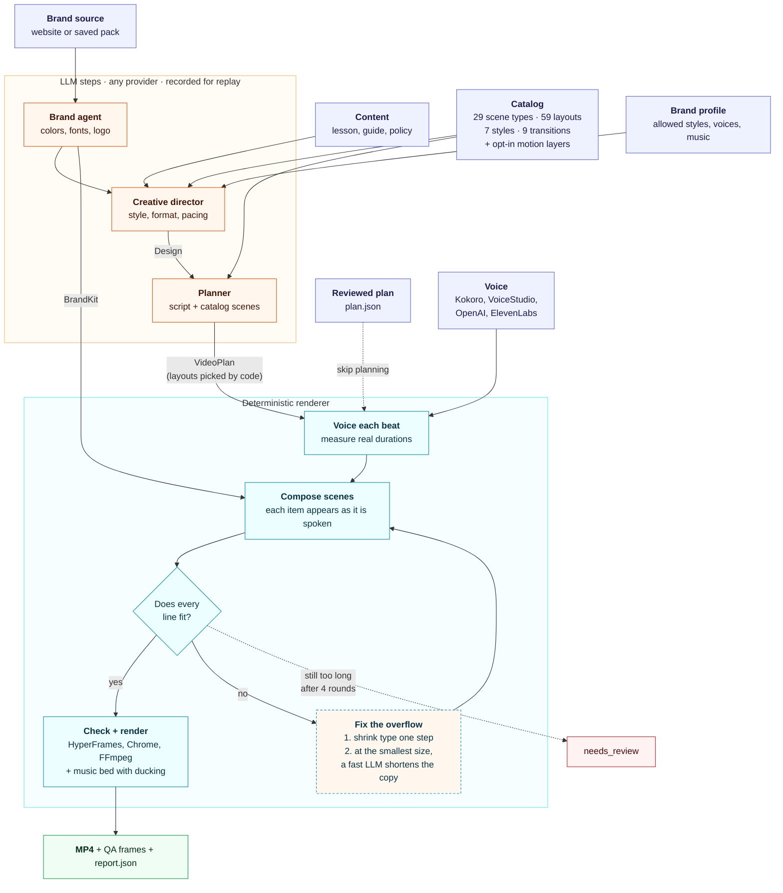

# Kinetry

Turn learning content and a brand into a short, narrated, on-brand video.

Give it a lesson, session guide or policy (text or Markdown) and a company website. Kinetry captures the brand (colors, fonts, logo) from the site, picks a look that suits the content, writes the script as a sequence of animated scenes, voices the narration, makes every element appear exactly when it's mentioned, checks that every line of text fits, and renders an MP4 in 16:9, 9:16 or 1:1.

## Try it in five minutes

```bash
pip install "kinetry[kokoro]"
kinetry setup      # once: the pinned renderer, GSAP and a browser
kinetry demo       # a 40-second video, made on your machine
```

`kinetry demo` needs no keys, no account and no model calls: it renders a ready-made plan in a bundled brand with the free local voice, and tells you exactly what to install if anything is missing. `kinetry demo --list` shows the others: `developer` (Kinetry explained in code scenes) and `spanish` (a lesson with captions and a two-person dialogue). Rendering takes a few minutes on a laptop.


## How it works



The model decides *what to say*, *how the brand looks* and *which look fits*; everything after that is deterministic code. More in [docs/ARCHITECTURE.md](docs/ARCHITECTURE.md).

- **Hundreds of looks from one catalog**: 29 scene types with 59 layouts, in 7 styles and 3 formats: 1,106 scene renderings, plus 7 motion packs, 9 transitions and five opt-in motion layers (camera, kinetic type, ambient light, animated illustrations and a 3D stage). A creative director picks the look from the content, audience and brand; you can pin any of it. See [docs/CATALOG.md](docs/CATALOG.md).
- **Deterministic rendering** on [HyperFrames](https://github.com/heygen-com/hyperframes): same plan + brand + voice → same frames.
- **Your model, your key**: Anthropic, OpenAI, Amazon Bedrock (any model), Google Gemini, Azure OpenAI, any OpenAI-compatible endpoint, or any LangChain chat model. Every model output is recorded, and runs can be replayed with no model calls.
- **Embeddable**: Python library, CLI, HTTP job service, MCP server, LangChain tools, Docker image.
- **Ready for an LMS, in many languages**: SCORM 1.2/2004 packages with captions, chapters, a transcript and a knowledge check grounded in the source; one reviewed course into many languages in one batch.
- **Cost**: about $0.06–0.11 per 90-second video with Claude Sonnet on Bedrock and the free local voice. Rendering takes about 4–5 minutes on 2 vCPUs.

## Install

Requires Python 3.10+, Node.js 22+ and FFmpeg.

```bash
pip install "kinetry[llms,kokoro]"
kinetry setup      # installs pinned HyperFrames + GSAP + Chrome into ~/.cache/kinetry
kinetry doctor
```

The first narration with the free local voice also downloads its model and voices (about 350 MB, cached by HyperFrames in `~/.cache/hyperframes/tts`), so the first run takes a few minutes longer. If you already have Chrome or Chromium, `kinetry setup --no-browser` with `KINETRY_BROWSER_PATH` pointing at it skips the browser download.

Extras:

| Extra | Adds |
|---|---|
| `bedrock` | Amazon Bedrock models (default LLM) |
| `anthropic`, `openai`, `google` | Claude API, OpenAI / Azure / OpenAI-compatible, Gemini |
| `llms` | All four model providers above |
| `kokoro` | Free local voice (Kokoro-82M) |
| `service` | HTTP job API (`kinetry serve`) |
| `mcp` | MCP server (`kinetry mcp`) |
| `all` | All of the above |

## Quick start

The examples use files from the repository, so run them from a clone of this repository. Planning from content needs a model: set `KINETRY_LLM` (for example `anthropic:claude-sonnet-5-5`) and the provider's key, or pass `--llm`.

```bash
kinetry sections examples/sources/first-team-meeting.md
kinetry brand https://example.com --save brands/example         # once per client
kinetry plan  examples/sources/first-team-meeting.md --section 2 --out plan.json   # review/edit
kinetry run   --plan plan.json --brand brands/example --out part2.mp4
kinetry preview plan.json --out storyboard/                          # one frame per scene, in seconds
```

### Sources

| Source | How it's split into sections (`--section N`) | Notes |
|---|---|---|
| Markdown, text, saved .html, .json | `##` headings | built in |
| Word (.docx) | Heading 1 | lists and tables kept as text; needs `kinetry[docs]` |
| PowerPoint (.pptx) | one per slide | slide text **and speaker notes**; needs `kinetry[docs]` |
| PDF | the PDF's bookmarks, else groups of 5 pages | running headers, footers and page numbers removed; needs `kinetry[docs]` |
| Web page (`https://...`) | the page's headings | main content only; pages built by JavaScript come back empty (save them as .html) |
| Audio or video recording | none | transcribed with Inworld `inworld-stt-1` |

`kinetry sections FILE_OR_URL` lists the sections. Over HTTP: `POST /v1/sources` (upload) and `POST /v1/sources/url`.

**Not supported yet** (they fail with a clear message): scanned PDFs (no OCR), legacy .doc/.ppt, course export zips (SCORM, Common Cartridge), and **long sources**: a source is limited to 12,000 words (about 25 pages) because nothing summarizes it before planning, so a long document becomes one video per section.

**Video kinds.** Say what the video is for and the planner follows a structure that fits it, with a default length and suitable scene types (an explicit length, design or brand profile still wins):

| Kind | Structure | Default length |
|---|---|---|
| `lesson` | why it matters → the idea with an example → doing it well (and a common mistake) → one thing to try | 90 s |
| `course_summary` | who it's for and the outcome → modules in order → how to start | 75 s |
| `session_recap` | which session → two or three takeaways → actions and next session (brisk) | 60 s |
| `explainer` | the problem → the idea with an analogy → how it works → why it matters | 75 s |
| `how_to` | what you'll be able to do → what you need → steps → how to check it worked | 60 s |
| `announcement` | the news → what changes and when → what to do → where to find more (brisk) | 45 s |
| `onboarding` | welcome → first days → people and places that help → the first thing to do | 75 s |

`--kind session_recap` on the CLI, `"kind"` on a source (HTTP, MCP, LangChain, `Source(kind=...)`), `GET /v1/kinds` for the list.

**From a request in plain words.** The brief agent turns a chat message into a structured request: kind, audience, length, language, format, captions, the content if it was pasted (kept word for word; never written by the model), a link to read, and questions for anything missing.

```bash
kinetry brief "a 60-second vertical how-to for new nurses on hand hygiene, in Spanish, with captions"
```

Over HTTP it's `POST /v1/briefs {"message": "..."}`, for agents the `brief_video` tool. With a model (`--llm` or `KINETRY_LLM`) it reads requests in any language; without one, keyword rules read English requests.

**Images.** The planner shows an image (an `image_caption` scene: full-bleed, beside the text, or as a framed print, with a slow Ken Burns drift) only when the request lists images, and only those. Give each one a note on what it shows:

```bash
kinetry run lesson.md --image "studio.jpg::the third-floor studio" --image "https://example.com/team.jpg::the team" --out tour.mp4
```

In Python or over HTTP, put them in the source's context: `"images": [{"ref": "upload:…", "about": "the third-floor studio"}]`. A ref is an https URL, `upload:<id>` (from `POST /v1/images`), `brand:<n>` (the n-th og:image found on the brand's site; use it only with the brand's permission) or, outside the service, a local file. PNG, JPEG, WebP and GIF up to 15 MB, checked from the bytes; SVG is refused. Images are copied into the project, so renders never fetch them. Use images you have the rights to.

Every design choice can be left to the creative director or set by hand:

```bash
kinetry run lesson.md --style warm --format 9:16 --captions --music bed.mp3 --out shift.mp4
kinetry run --plan examples/plans/feedback-that-lands.json --voice-a kokoro:af_heart --voice-b kokoro:am_adam --out f.mp4
kinetry profile brands/example --styles editorial,minimal --avoid sticky_tip --voice narrator=kokoro:bf_emma
```

Try it offline with recorded model outputs (no AWS needed):

```bash
kinetry run examples/sources/first-team-meeting.md --section 2 \
  --brand tests/fixtures/fernhill-probe.json \
  --replay examples/replay/run-the-room-fernhill --out run-the-room.mp4
```

Python:

```python
from kinetry import Kinetry, load_source

tf = Kinetry(llm="anthropic:claude-sonnet-5-5")       # or openai:gpt-4.1, bedrock:<model id>, ...
pack = tf.brand("https://example.com")                  # BrandPack: kit + logo; pack.save("brands/example")
plan = tf.plan(load_source("lesson.md", section=2), brand=pack,
               design={"format": "9:16"})              # VideoPlan (pydantic): review, edit, store
tf.preview(plan, brand=pack, out_dir="storyboard")      # silent frames, one per scene
result = tf.render(plan, brand=pack, out="lesson-2.mp4", music="bed.mp3")
print(result.status, result.video, result.qa_frames)
```

`result.status` is `done`, `needs_review` (text still didn't fit after the repair rounds), `check_failed` or `error`. `report.json` in the run directory says why.

## Models

Pick any provider and model, and bring your own key:

| Spec | Key | Notes |
|---|---|---|
| `anthropic:claude-sonnet-5-5` | `ANTHROPIC_API_KEY` | also `claude-opus-5-5`, `claude-haiku-4-5-20251001` |
| `openai:gpt-4.1` | `OPENAI_API_KEY` | reasoning models (`gpt-5`, `o3`...) work; temperature is left at default |
| `bedrock:<model id or inference profile>` | AWS credential chain, or a Bedrock API key | any Bedrock text model: Claude, Nova, Llama, Mistral, DeepSeek... |
| `google:gemini-2.5-pro` | `GOOGLE_API_KEY` | |
| `azure:<deployment>` | `AZURE_OPENAI_API_KEY` | plus `base_url` (your endpoint) |
| `openai_compatible:<model>` | `OPENAI_API_KEY` or `api_key` | plus `base_url`: OpenRouter, Groq, Together, vLLM, LiteLLM... |
| `mistralai:`, `groq:`, `ollama:`, `xai:`, `deepseek:`... | provider's env var | any LangChain provider, after `pip install langchain-<provider>` |

```python
from kinetry import Kinetry, LLMConfig, list_models

tf = Kinetry(llm=LLMConfig("openai", "gpt-4.1", api_key=user_key),           # plans + brand
               llm_fast=LLMConfig("openai", "gpt-4.1-mini", api_key=user_key))  # copy rewrites
tf = Kinetry(llm=LLMConfig("bedrock", "amazon.nova-pro-v1:0", region="us-west-2",
                             aws_access_key_id=..., aws_secret_access_key=...))
plan = tf.plan(src, llm="anthropic:claude-opus-5-5")                           # per-call override
list_models("bedrock")                                                          # what your account can call
```

```bash
kinetry models bedrock                     # every Bedrock model and inference profile you can use
kinetry run lesson.md --llm google:gemini-2.5-pro --llm-fast google:gemini-2.5-flash --out w1.mp4
```

Keys are held as `SecretStr` and never written to run reports, job records or logs. Through the HTTP service, each request can carry its own `llm` block (see [docs/INTEGRATION.md](docs/INTEGRATION.md#bring-your-own-model)). Models without tool calling are supported through a JSON-schema fallback.

## Using it from other systems

See [docs/INTEGRATION.md](docs/INTEGRATION.md). In short:

| You have | Use |
|---|---|
| A Python service or pipeline | `from kinetry import Kinetry` |
| Services in other languages, or many callers | `kinetry serve` (HTTP jobs) or the Docker image |
| An agent platform (LangChain/LangGraph) | `kinetry.integrations.langchain.make_tools()` |
| An MCP-capable agent or IDE | `kinetry mcp` |
| A batch job (e.g. a course builder) | the Python API in a worker, or the HTTP API from your queue |

## Lessons for an LMS

A video becomes a lesson an LMS can import in one more step:

```bash
kinetry run lesson.md --brand brands/acme --out lesson.mp4 --package scorm12   # writes lesson.zip too
kinetry package RUN_DIR --out lesson.zip --standard scorm2004 --quiz 4 --mastery 75
kinetry package RUN_DIR --out lesson-web.zip --standard web --quiz off        # a plain zip for any website
```

The package holds the video, **captions** (WebVTT, with speaker names in dialogues), **chapters** (one per scene), a **transcript** (on the page, synced and clickable, and as a download), and an optional **knowledge check**: 1–6 multiple-choice questions written from the same source, each with a one-line explanation. A question is kept only if the model quoted, word for word, the part of the source that supports it; anything it can't back up is dropped (the run's `quiz.json` keeps what was kept). Bring your own questions with `--quiz-file`.

The player reports to the LMS the standard way (SCORM 1.2 `cmi.core.*` or SCORM 2004 `cmi.*`): `incomplete` on start; watched once 90% of the video has actually been seen (skipping ahead doesn't count); then the score and `passed`/`failed` against the mastery score, or `completed` when there's no quiz. Progress and answers are saved for resuming, and the session time is reported on exit. Without an LMS the same page works on its own.

Python: `tf.package(result, out="lesson.zip", standard="scorm2004", questions=4)`. Over HTTP: add `"package": {"standard": "scorm12", "quiz": 3, "mastery": 80}` to `POST /v1/videos` and download `GET /v1/videos/{id}/package` (also in the callback as `package_url`). Every run now also writes `timing.json` (scenes, beats and caption cues with their real times), which is what packages are built from.

## One course, many languages

A reviewed plan (or a finished run) becomes the same video in other languages, as one batch:

```bash
kinetry localize plan.json --to es,fr,zh --brand brands/acme --out-dir out/i18n
kinetry localize out/run --to de,ar --voice de=inworld:inworld-tts-1:<german-voice> --voice ar=inworld:inworld-tts-1:<arabic-voice> \
  --out-dir out/i18n --package scorm12          # an LMS package per language too
kinetry localize plan.json --to es,pt-BR --translate-only --out-dir out/i18n   # plans to review first
```

Only the words change. Scenes, layouts, reveal order, brand and design stay exactly as reviewed; each language's timing comes from its own narration, and the fit check runs again per language (long German headlines shrink or get shortened like any other). The model translates the whole plan in one call, so terms stay consistent between narration and screen, and within each on-screen field's width limit; code, commands, web addresses and numbers are left as they are. Anything missing or too long gets one more try; anything still wrong fails that language with a clear error and the rest of the batch carries on.

Voices: languages Kokoro speaks (en, es, fr, hi, it, pt, zh) get local voices automatically, with a different voice for each speaker where Kokoro has one. Any other language needs a cloud voice per language (`--voice LANG=SPEC`, or `LANG.ROLE=SPEC` for one speaker; `kinetry voices inworld` lists what your account has), and every language is checked for a usable voice before anything is translated or rendered. Right-to-left scripts are laid out right to left. The out dir gets `<name>.<lang>.plan.json`, `.mp4` (and `.zip`), and `localize.json` with each language's status.

Python: `tf.localize("plan.json", to="es,fr", out_dir="out/i18n", voices={"ar": "inworld:inworld-tts-1:<arabic-voice>"}, package="scorm12")`.

## Voices

| Spec | Voice |
|---|---|
| `kokoro:af_heart`, `kokoro:am_michael`, `kokoro:bf_emma`, … | Local Kokoro-82M, free, CPU: 54 voices (28 English); `kinetry voices kokoro` lists them |
| `voicestudio:<profile_id>` | A saved voice on your [VoiceStudio](https://github.com/debpalash/VoiceStudio) server |
| `voicestudio:design=<description>` | A designed voice, e.g. `voicestudio:design=female, middle-aged, low pitch, american accent` |
| `openai:coral`, `openai:onyx`, … | OpenAI `gpt-4o-mini-tts` (`OPENAI_API_KEY` or `voice_api_key`) |
| `elevenlabs:<voice_id>` | Any voice in your ElevenLabs library, including voices you cloned there (`ELEVENLABS_API_KEY`) |
| `inworld:<voice_id>`, `inworld:<model>:<voice_id>` | Inworld built-in or cloned voices (`INWORLD_API_KEY`). Models: `inworld-tts-2` (default, quality), `inworld-tts-2-flash` (faster, cheaper), `inworld-tts-1` (retired by Inworld; requests are rerouted) |
| any object with `synthesize(text, out_path) -> Clip` | Your own TTS (pass as `voice=`) |

```bash
kinetry voice-design --name Coach --description "male, middle-aged, low pitch, british accent"
kinetry voice-clone --name Dana --ref dana.wav --consent-audio dana-consent.wav \
  --consent-text "I, Dana Lee, agree to my voice being used for training videos."
```

**Casts** name characters once and reuse them across role-play videos: a JSON file of `{id, label, voice, appearance}` entries (see `examples/casts/`). `kinetry run --plan p.json --cast cast.json --speaker a=skeptic_female --speaker b=newcomer_male`, or `voices=load_cast(path).voices({...})` in Python. `kinetry cast cast.json --verify` checks every Inworld voice id against your account. `appearance` is carried for an avatar step (for example a LiveAvatar avatar); Kinetry doesn't render avatars.

**Speech to text** (Inworld `inworld-stt-1`, `INWORLD_API_KEY`):
- Recordings as sources: `kinetry plan town-hall.mp4 --out plan.json` transcribes audio or video (mp3, wav, m4a, mp4, mov, webm, ...) and plans from the transcript. `kinetry transcribe FILE [--json]` gives just the text and word timings.
- Voice check: `kinetry run ... --voice-check` listens back to every narrated line and flags lines whose audio doesn't match the script (dropped or garbled words, numbers read oddly). Scores are in `report.json` under `voice_check`; flagged lines don't fail the render. In the API: `voice_check=True` (or a transcriber), `stt_api_key=`; over HTTP: `"voice_check": true` with `stt_api_key` (or `voice_api_key` when the narrator is an Inworld voice).

Cloning always requires a consent recording and statement from the speaker, and the service only offers it when `KINETRY_VOICE_CLONING=1`. VoiceStudio is AGPL-3.0 and is only called over HTTP, never bundled. It needs a GPU server for practical speed; see [docs/VOICES.md](docs/VOICES.md) for what cloning takes.

## Brand rules enforced in code

- Text colors are darkened until they pass WCAG AA on the video background. Shapes keep the vivid brand color when it reaches 3:1.
- Proprietary fonts are swapped for close open fonts, and every swap is logged. Put a licensed WOFF2 in the font cache to use the real font.
- The logo is dropped, with a note, if its colors wouldn't stand out on the background.
- CMS and widget defaults (`--wp--preset-*`, `--swiper-*`, validation colors) are ignored.

Use a client's logo and fonts only with their permission.

## Configuration

| Variable | Default | Purpose |
|---|---|---|
| `KINETRY_HOME` | `~/.cache/kinetry` | Toolchain, fonts and voice cache |
| `KINETRY_BROWSER_PATH` | HyperFrames' Chrome | Use your own Chrome/Chromium |
| `KINETRY_LLM` | `bedrock` | Default model: `provider:model`, a bare provider, or `replay` |
| `KINETRY_LLM_FAST` | same as `KINETRY_LLM` | Cheaper model for copy rewrites |
| `KINETRY_BEDROCK_MODEL` | Claude Sonnet 4.5 inference profile | Model used when `KINETRY_LLM=bedrock` |
| `ANTHROPIC_API_KEY`, `OPENAI_API_KEY`, `GOOGLE_API_KEY`, `ELEVENLABS_API_KEY`, `INWORLD_API_KEY` | | Provider keys for the server's own models and voices |
| `AWS_REGION` + AWS credentials | | Bedrock access (standard AWS chain) |
| `KINETRY_VOICESTUDIO_URL`, `KINETRY_VOICESTUDIO_API_KEY` | `http://127.0.0.1:3900` | VoiceStudio server |
| `KINETRY_API_KEY` | | Bearer token for the HTTP service |
| `KINETRY_DATA_DIR` | `$KINETRY_HOME/data` | Jobs and brand packs for the service |
| `KINETRY_S3_BUCKET` (+ `_PREFIX`, `_ENDPOINT_URL`, `_REGION`, `_URL_EXPIRES`, `_DELETE_LOCAL`) | | Upload finished videos to S3-compatible storage ([docs/DEPLOY.md](docs/DEPLOY.md)) |
| `KINETRY_CALLBACK_SECRET`, `KINETRY_PUBLIC_URL` | | Signing key and base URL for job callbacks |
| `KINETRY_QUALITY` | `standard` | Output encoding: `draft`, `standard`, `high` or a CRF number (see [docs/QUALITY.md](docs/QUALITY.md)) |
| `KINETRY_WORKERS` | `1` | Concurrent renders per service process |
| `KINETRY_CLIENT_LLM` | `byok` | Service callers may choose models: `off`, `byok` (only with their own key), `any` |
| `KINETRY_LLM_PROVIDERS` | all built-in | Comma list of providers callers may use |
| `KINETRY_VOICE_PROVIDERS` | all | Comma list of voice providers callers may use |
| `KINETRY_VOICE_CLONING` | off | `1` enables `POST /v1/voices/clone` |

## The look: scenes, styles, formats

Everything visual comes from a catalog in `src/kinetry/design/`, and [docs/CATALOG.md](docs/CATALOG.md) is generated from it.

| Layer | What it is | Options |
|---|---|---|
| Scene types | what a scene *says*: fields, limits, reveal keys, layouts | title, chapter, closer, split_list, card_grid, icon_grid, question_cards, checklist, numbered_steps, steps_path, agenda_timeline, journey, comparison, do_dont, instead_try, bar_chart, big_stat, pull_quote, definition, sticky_tip, annotated_mock, dialogue, chat_thread, code_snippet, line_chart, decision, image_caption (when images are supplied), and statement (with kinetic type on) |
| Layouts | how it's arranged; picked by code, seeded, never repeated back to back | 1–2 per scene type, each tagged with the formats it supports |
| Styles | the ground, type scale, fonts, radius, shadows, chrome | editorial, technical, warm, bold, minimal, corporate, classic |
| Motion packs | how things enter and exit | one per style, or set `motion` |
| Transitions | between scenes | exit, cut, fade, push, rise, iris, wipe, scan, scribble |
| Formats | the frame | 16:9, 9:16, 1:1 (captions on by default for the last two) |

The brand's colors and fonts flow into every style, and contrast is enforced for each one (including inverse scenes set on the brand color). `kinetry gallery --out gallery/` renders every scene type and layout in every style and format, runs the HyperFrames checks on each, and writes a page to browse them.

**Brand profiles** hold a company's standing choices (allowed styles, a pinned format, scene types to avoid or favor, voices per role, a music bed, notes) in `profile.json` next to the brand pack. The director treats them as constraints; a request can still override them.

**Motion layers** are opt-in extras on top of any style, off by default so a plain video is unchanged:

| Layer | subtle | rich |
|---|---|---|
| camera | slow push-in and background parallax on every scene | directional drift, plus a punch-in on each scene's key moment |
| kinetic | headline words rise into place; key words pop | words flip in with depth; enables the `statement` scene, whose words land as they're spoken |
| ambient | soft drifting pools of brand color (a moving spotlight in `technical`) | adds slow-rising particles |

```bash
kinetry run lesson.md --effects subtle --out lesson.mp4              # all three layers
kinetry run lesson.md --effects rich --ambient off --out lesson.mp4  # or layer by layer
kinetry profile brands/acme --effects subtle                         # a brand's default
```

Ambient light is capped per style and ground so text over it keeps its WCAG contrast; on light grounds that keeps it gentle. Camera moves are small enough to keep content inside the safe area.

Two heavier layers are only ever on when you name them (`--effects` doesn't touch them):

| Layer | subtle | rich |
|---|---|---|
| illustration | enables the `illustration` scene type: eight original animated illustrations (idea, team, growth, security, checklist, conversation, time, goal) in the brand's colors, or your own Lottie file | parts keep moving gently (floating, swinging, a clock that runs); a Lottie loops for the scene |
| depth | a 3D stage behind the scenes (Three.js) with a camera that glides from one scene to the next, past the brand's own 3D models (where it has shared some), its logo mark in 3D and abstract shapes in its colors | more movement, a slow camera sway |

```bash
kinetry run lesson.md --illustration rich --out lesson.mp4
kinetry run lesson.md --depth subtle --out lesson.mp4
```

#### The brand's own 3D models

Nothing on the 3D stage is drawn for a particular business. What stands there comes from the brand:

- **Its own models.** A company shares 3D models of its products, vehicles, mascot or logo as binary glTF (`.glb`, everything embedded, up to 25 MB, no Draco/meshopt/Basis compression). They're kept in the brand pack (`assets3d/`) and played as they are: their own materials, lit by a soft studio environment, their own animations seeked to the scene's clock, or a slow turn when they have none.
- **Its logo mark**: the symbol alone, extruded in 3D on title and closing scenes.
- **Abstract shapes** in its colors everywhere else.

An **asset agent** does the work around the models. It checks each file, reads it (parts, materials and colors, size, triangle count, animations) and describes it: a sentence, tags a script about it would use, and a role (`hero` for products and mascots, which open the video; `logo`, which closes it; `prop` for everything else). It uses a model when one is configured (`--llm` or `KINETRY_LLM`), else the names inside the file, and the brand's own words always win. For each video it lists, per scene, the models whose tags the scene's words mention; the stage then places each one only where the scene's settled layout leaves room (a strip on the side the text doesn't start from, else a band under the content), never the same model on neighbouring scenes, and shows models nothing mentions on spare scenes with room, so each appears once. `design.effects.depth_models` is `auto`, `off`, or `{"2": "water-bottle"}` to place them by hand.

When a brand is made from its website, the agent also takes what it can from there: 3D models the site shows or loads (`<model-viewer>`, `.glb` links, files fetched by its scripts), downloaded with the same public-address checks as the rest of the probe, and the logo's symbol, cut out of a logo that pairs a symbol with a wordmark and traced to SVG (`pip install 'kinetry[brand3d]'`).

```bash
kinetry assets3d brands/acme add scooter.glb --role hero        # check, read, describe, keep
kinetry assets3d brands/acme add https://acme.com/models/helmet.glb
kinetry assets3d brands/acme describe helmet --tags "helmet,safety,ride"   # correct the agent
kinetry assets3d brands/acme list
kinetry assets3d brands/acme mark                                # cut the symbol out of the pack's logo
kinetry profile brands/acme --mark mark.svg                      # or give it yourself
```

Over HTTP: `POST /v1/brands/{id}/assets3d` (multipart `file`, optional `name`, `about`, `tags`, `role`), `GET /v1/brands/{id}/assets3d`, `DELETE /v1/brands/{id}/assets3d/{asset_id}`, `PUT /v1/brands/{id}/mark`. Use models the brand owns or has the rights to; the agent records where each one came from. Phone frames keep the light abstract shapes unless a scene has a band free under its content.

Lottie files come in like images: list them in the source's `context.animations` (`[{"ref": "upload:…", "about": "a rocket launching"}]`); upload with `POST /v1/images` (it takes Lottie JSON too). They're checked (3 MB, embedded images only) and played by lottie-web's light player, which runs no expressions. The 3D stage renders in software when there's no GPU, which makes rendering slower; scenes set on the brand color keep their solid ground. Both players are installed by `kinetry setup` and copied only into projects that use them.

**Dialogue** scenes are voiced line by line with a voice per speaker (`--voice-a`, `--voice-b`, or `voices={"a": ..., "b": ...}`). **Music**: pass any licensed track; it loops, fades, and ducks under the voice.

To add a scene type: a folder in `design/components/<id>/` with `component.json` (fields, limits, reveal keys, layouts, an example), `template.html`, `style.css` and `motion.js`. The planner guide, validation, gallery and docs pick it up from the manifest. Styles are a `style.json` of tokens plus optional CSS.

## Development

```bash
pip install -e ".[dev,kokoro]" && kinetry setup
ruff check src tests && ruff format --check src tests
pytest                    # unit + integration tests; no Chrome, keys or model calls needed
kinetry gallery --out gallery/ --styles editorial --formats 9:16   # visual regression check (needs Chrome)
kinetry catalog --markdown > docs/CATALOG.md                         # after changing the catalog
```

The **Render smoke test** workflow renders real videos from recorded outputs and golden plans (`examples/plans/`) plus a gallery slice, and uploads them with QA frames. It runs weekly, on demand, and on PRs that touch the renderer.

**Live checks** use real accounts, with your keys in your own environment:

```bash
kinetry check-llm --llm bedrock:<model id or inference profile> [--render]   # director + script writer (+ a video)
kinetry check-inworld [--cast cast.json]                                     # Inworld voices, TTS models, STT
kinetry check-voices openai:coral elevenlabs:<voice_id>                      # synthesize, then listen back
```

The **Live checks** workflow (Actions > Live checks > Run workflow) does the same on GitHub with repository secrets (`AWS_ACCESS_KEY_ID`/`AWS_SECRET_ACCESS_KEY` or `AWS_BEARER_TOKEN_BEDROCK`, `ANTHROPIC_API_KEY`, `OPENAI_API_KEY`, `ELEVENLABS_API_KEY`, `INWORLD_API_KEY`); each check runs only when its secret is set. Without any secrets it still probes a live website for a brand and renders a video in it. Results and media are uploaded as the `live-checks` artifact.

## Limits

- Narration is model-written. It's constrained to the source's facts, but keep a human review step for anything learners see.
- Very short narration fragments can sound clipped. Keep beats to full sentences or clauses.
- Languages: Kokoro narrates English, Spanish, French, Italian, Brazilian Portuguese, Hindi and Mandarin; Japanese, Farsi, Arabic, Hebrew, Urdu and others need a cloud voice. Right-to-left scripts are laid out right to left ([docs/VOICES.md](docs/VOICES.md#languages)).
- One render uses about 2 vCPUs for 4–5 minutes per 90 seconds of video. Scale out with more workers (or HyperFrames' Lambda rendering).

## Contributing

Bug reports, scene types, styles and fixes are welcome: see [CONTRIBUTING.md](CONTRIBUTING.md). Report security problems privately ([SECURITY.md](SECURITY.md)).

## License

Kinetry is licensed under the [Apache License 2.0](LICENSE); see [NOTICE](NOTICE) for the work it adapts.

It doesn't bundle its renderer or animation library: `kinetry setup` installs HyperFrames (Apache-2.0), GSAP, three.js, lottie-web and Lucide, each under its own license, and FFmpeg, Chromium and Kokoro come with their own terms. GSAP in particular is free to use but isn't open source; read its [standard license](https://gsap.com/standard-license) for your use. [THIRD_PARTY.md](THIRD_PARTY.md) lists everything.

Brand assets captured from a website belong to that website's owner. Use them only with permission.
