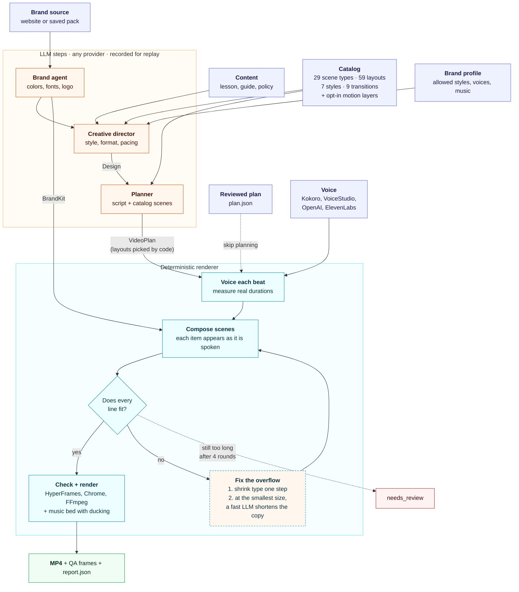
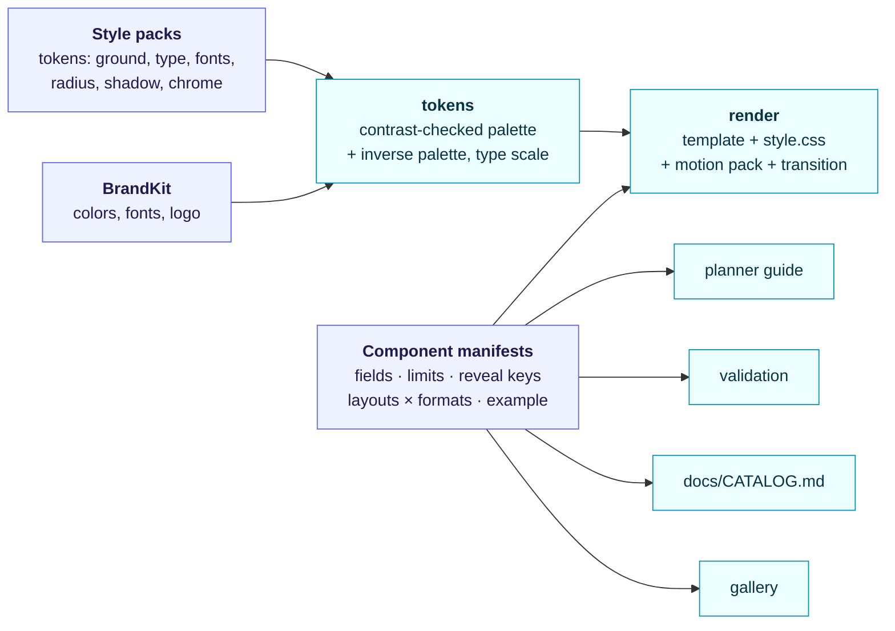
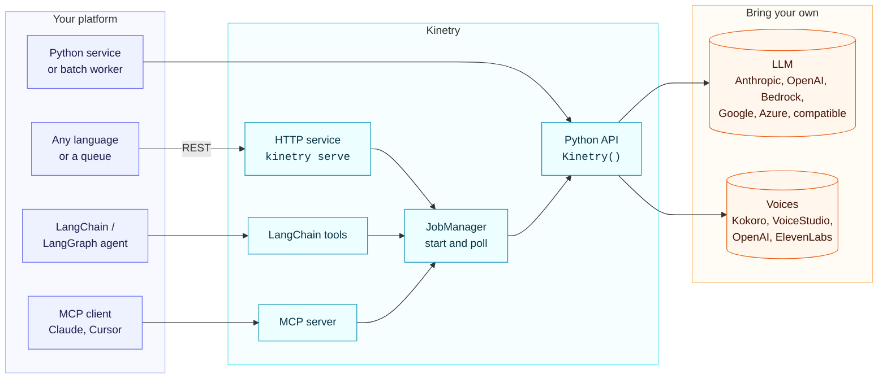
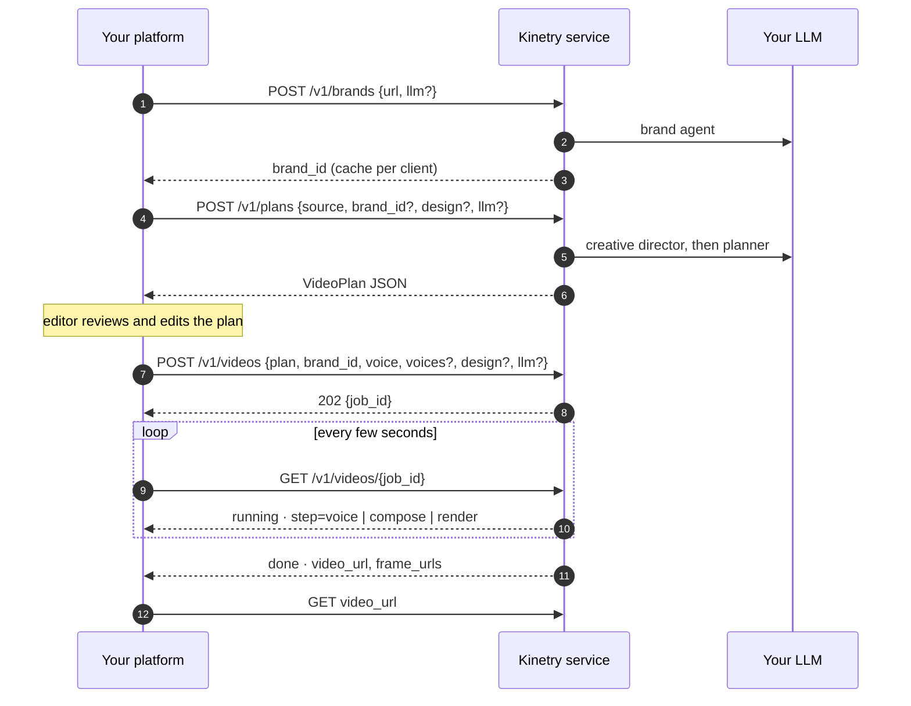

# How Kinetry works

Kinetry has two halves. **LLM steps** decide what to say, how the brand looks and which look fits. A **deterministic renderer** turns those decisions into frames. The model never writes HTML or animation code, so any capable model gives a correct video, and the same plan, brand and voice always give the same frames.

| Step | What it does | Uses an LLM? | Output |
|---|---|---|---|
| Brand agent | Reads the site (real browser, computed styles, logo), checks contrast and font availability with tools, picks colors and fonts. | yes (`llm`) | `BrandKit` + logo, saved as a brand pack (with an optional `profile.json`) |
| Creative director | Picks the style, format, transition, pacing and captions from the content, audience and brand, within the brand profile's limits; names scene types that suit the content. Falls back to a keyword heuristic with no model. Anything the request sets wins. | yes (`llm`), optional | `Design` |
| Planner | Turns the content into narration beats and catalog scenes. Its guide is generated from the component manifests; the catalog validates every field, limit, reveal key and dialogue voice, and errors go back to the model. | yes (`llm`) | `VideoPlan` v2 (JSON you can review and edit) |
| Layout picker | Chooses each scene's layout: only layouts that support the format, nudged by the style, never the same layout twice in a row for a type, seeded so reruns match. | no | layouts filled in |
| Brand rules | Darkens text until it passes WCAG AA, swaps proprietary fonts for open ones, drops a logo that won't show up. | no | the kit actually used |
| Voice | Speaks each beat separately (dialogue lines in each speaker's voice) and measures its real length. | no | WAV per beat, timeline |
| Compose | Renders each scene's template with the style's tokens, the motion pack and the transition. Each item appears on the beat that mentions it. | no | HTML + GSAP timeline |
| Fit check | Measures every text field in Chrome: line count, overflow, single-word last lines. | no | list of problems |
| Fix the overflow | Shrinks type one step where the template allows it. At the smallest size, asks a model to shorten the copy. | only for rewrites (`llm_fast`) | updated composition |
| Check + render | HyperFrames lint, then render with Chrome and FFmpeg, then a QA frame per scene. | no | MP4, PNGs, `report.json` |
| Music | Loops a music bed under the voice, fades it, and ducks it with a sidechain compressor. | no | MP4 with the mix |

Every model output is saved under `<run>/llm/`. Running with `--replay <dir>` (or `KINETRY_LLM=replay`) reuses them with no model calls, which is how CI renders real videos without keys.

## The design engine

- **A scene is data.** `{type, layout, data, beats}`. The component's manifest says which fields exist, their limits, which keys a beat can reveal, and which layouts work in which format. One manifest feeds the planner, validation, docs and the gallery, so they can't drift apart.
- **Styles are tokens.** Each style sets the ground (brand tint, paper, white, dark), a type scale by role, which brand font plays which role, radius, shadow, chrome and inverse scenes. Brand colors pass through contrast checks for each style, so a dark style with a dark brand color still reads.
- **Formats are variables.** One template serves 16:9, 9:16 and 1:1 through scale and safe-area variables; layouts declare which formats they support.
- **Motion is a shared API.** Templates call `head`, `text`, `item`, `card`, `mark`, `emph`, `line` and `out`; each motion pack implements them, so swapping the pack changes how everything moves without touching templates.
- **Motion layers are separate and opt-in.** Camera rigs wrap the stage, ambient light sits in the ground, and kinetic type wraps the motion pack. With `effects` off none of it reaches the page. Ambient strength is computed per ground so text keeps its contrast, and every "random" placement comes from a PRNG seeded by the scene id.
- **Fit stays measurable.** Every text element carries `data-field` and `data-max-lines`; the fit loop measures the real layout and shrinks type by role before asking a model to rewrite.

## Choosing models

Two roles, each any provider:

- `llm`: planning and branding. These need a strong model.
- `llm_fast`: copy rewrites in the fit loop. Small, frequent jobs, so a cheaper model is fine. Defaults to `llm`.

A model is a `provider:model` spec, an `LLMConfig` (to pass your own key, endpoint or AWS credentials) or any LangChain chat model. Models without tool calling still work: structured output falls back to a JSON-schema prompt, and the brand agent gets its evidence up front instead of through tools.

## Where Kinetry sits

Rendering takes minutes, so everything except the Python API is start-and-poll:

