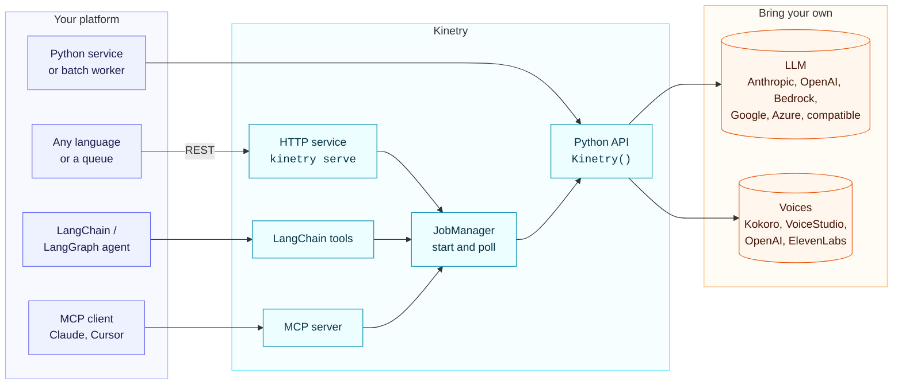
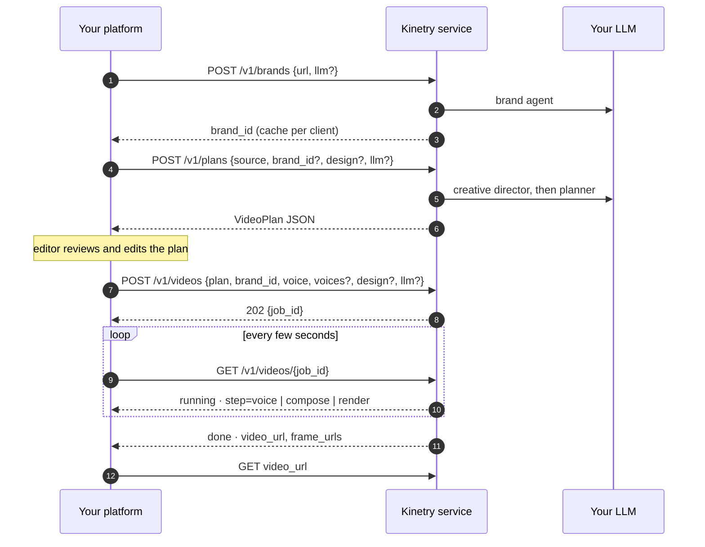

# Integrating Kinetry

Kinetry is a capability other systems call: "turn this content into a branded video". This page covers how to plug it into a platform, from the simplest option to the most decoupled.



## The contract

Whatever the transport, the inputs and outputs are the same.

**In**
- `Source`: `text` (plain text or Markdown), `title`, `context`. Context is for facts the planner should know but that aren't in the text, such as audience, program name, session N of M, sibling session titles, or language.
- **Brand**: a website URL (probed once, then cached as a `BrandPack`) or a saved brand pack.
- **Voice**: a voice spec or your own TTS object, plus optional voices per role (`voices={"a": ..., "b": ...}`) for dialogue scenes.
- **Design** (optional): any of `style`, `format` (16:9, 9:16, 1:1), `motion`, `transition`, `pacing`, `captions`, `seed`, `lang`, and `effects` (opt-in motion layers: `{"level": "subtle"}` or per layer `{"camera": "rich", "kinetic": "off", "ambient": "subtle"}`). Whatever you leave out, the creative director picks within the brand profile. `GET /v1/catalog` lists the options.
- **Model** (optional): which LLM, with whose key. Default is the server's configured model.
- Optionally a reviewed `VideoPlan` instead of a source, to skip planning.

**Out**
- MP4 (1920×1080, 1080×1920 or 1080×1080, 30 fps, AAC).
- QA frames, one PNG per scene.
- The final `VideoPlan`, including any copy the fit loop rewrote.
- `report.json`: every step, brand decisions, font substitutions and timings.
- A status: `done | needs_review | check_failed | error`.

Your platform owns its own data model. Convert your objects to `Source` at the boundary, and keep IDs in `metadata` (HTTP) or your own job table.

## Pattern 1: import it (Python services and pipelines)

```python
from kinetry import Kinetry, Source, BrandPack

tf = Kinetry(llm="bedrock:us.anthropic.claude-sonnet-4-5-20250929-v1:0",  # spec, LLMConfig or chat model
               workdir="/var/kinetry/runs")

def video_for_lesson(lesson, tenant):
    pack = brand_cache.get(tenant.id) or tf.brand(tenant.website)  # cache per tenant
    src = Source(text=lesson.body_markdown, title=lesson.title,
                 context={"audience": lesson.audience, "section_number": lesson.position,
                          "section_count": lesson.course.length,
                          "all_sections": [l.title for l in lesson.course.lessons]})
    plan = tf.plan(src, brand=pack,          # the look is picked from the content and the brand profile,
                   design={"format": "16:9"})  # or pinned here
    return tf.render(plan, brand=pack, out=f"/media/{lesson.id}.mp4")  # store the plan; let an editor approve it
```

Best when the caller is already Python and runs on a machine with the toolchain (`kinetry setup`, or the Docker image as the base).

## Pattern 2: the HTTP service (any language, many callers)

```bash
docker build -t kinetry .
docker run -p 8080:8080 -e KINETRY_API_KEY=... -e KINETRY_LLM=anthropic:claude-sonnet-5-5 \
  -e ANTHROPIC_API_KEY=... -v kinetry-data:/data kinetry
```

Run it with Docker or, where containers aren't allowed, with `sudo deploy/install.sh` under systemd ([DEPLOY.md](DEPLOY.md)). Add `"callback_url"` to `POST /v1/videos` to be called back (signed) when the job finishes instead of polling, and set `KINETRY_S3_BUCKET` to have finished videos uploaded to object storage.

The image runs as a non-root user (uid 10001), keeps jobs in the `/data` volume and ships with the local Kokoro voice already downloaded, so it renders without internet access when given a plan and local voices. CI builds it on every pull request and runs `docker/smoke.py` against it: start the container, refuse a request without the key, render `docker/smoke-plan.json` through `POST /v1/videos`, download the MP4 and check its streams. Run the same check locally with `docker build -t kinetry:ci . && python docker/smoke.py`.

```http
GET  /v1/catalog                                                    -> scene types, layouts, styles, transitions, formats
POST /v1/brands   {"url": "https://customer.example"}              -> {"brand_id": "...", "kit": {...}}
PUT  /v1/brands/{id}/profile {"styles": ["editorial", "minimal"], "format": "9:16",
                   "avoid_components": ["sticky_tip"], "voices": {"narrator": "kokoro:bf_emma"}} -> brand + profile
POST /v1/sources  multipart file=@lesson.pptx [section=2]                -> {"source": {...}, "sections": [...]}  (.docx .pptx .pdf)
POST /v1/sources/url {"url": "https://...", "section": 2}                 -> same, from a public web page
GET  /v1/kinds                                                      -> video kinds for source.kind (lesson, session_recap, how_to, ...)
POST /v1/briefs   {"message": "60s vertical recap for the sales team: <notes>"} -> {"brief": {...}, "request": {...}}
POST /v1/images   multipart file=@studio.jpg                                 -> {"ref": "upload:<id>"}  for source.context.images
POST /v1/plans    {"source": {"text": "...", "title": "..."}, "brand_id": "...",
                   "design": {"style": "warm"}}                      -> VideoPlan (review step)
POST /v1/videos   {"plan": {...}, "brand_id": "...", "voice": "kokoro:af_heart",
                   "voices": {"a": "kokoro:af_heart", "b": "kokoro:am_adam"},
                   "metadata": {"course_id": "c-42", "lesson_id": "l-7"}}   -> 202 {"job_id": "..."}
POST /v1/models   {"llm": {"provider": "bedrock", "region": "us-west-2", ...}} -> models those credentials can use
POST /v1/voices/design  {"name": "Coach", "description": "..."}         -> {"voice": "voicestudio:<id>"}
POST /v1/voices/clone   multipart (KINETRY_VOICE_CLONING=1)           -> {"voice": "voicestudio:<id>"}
GET  /v1/videos/{job_id}            -> {"status": "running", "step": "render"} ... {"status": "done", "video_url": ...}
GET  /v1/videos/{job_id}/video      -> MP4
GET  /v1/videos/{job_id}/frames/0   -> QA frame
```

The job lifecycle:



Each process renders `KINETRY_WORKERS` videos at a time (default 1). For more throughput, run more containers behind a queue: your queue calls `JobManager.start` (or the API) and the job directory holds everything.

Security defaults:
- A bearer token is required for non-local calls.
- Brand URLs that resolve to private, link-local, CGNAT or metadata addresses are refused, and so is every redirect and every request the brand probe's browser makes.
- Only known voice prefixes are accepted, with safe voice ids; voices in a plan or brand profile follow the same rules as request voices.
- Callers' API keys are used for their request only. They are never stored, logged or returned.
- A caller-supplied `base_url` must be a public address, needs the caller's own key (the server never lends its keys to another endpoint), and redirects aren't followed.
- Server paths are never returned, and callers can't point a brand profile at a server file (music beds are set by the operator with `kinetry profile`).
- Design values are checked against the catalog; plans are validated field by field before anything renders.

### Bring your own model

Every brand, plan and video request can name its model and carry the caller's key. This lets each tenant use, and pay for, its own model.

```json
POST /v1/videos
{
  "plan": {...}, "brand_id": "...",
  "llm": {"provider": "anthropic", "model": "claude-sonnet-5-5", "api_key": "sk-ant-..."},
  "voice": "elevenlabs:21m00Tcm4TlvDq8ikWAM", "voice_api_key": "..."
}
```

| `llm.provider` | Fields |
|---|---|
| `anthropic`, `openai`, `google` | `model`, `api_key` |
| `bedrock` | `model` (any model id or inference profile), `region`, and either `api_key` (a Bedrock API key) or `aws_access_key_id` + `aws_secret_access_key` (+ `aws_session_token`) |
| `azure` | `model` (deployment), `base_url`, `api_key`, optional `api_version` |
| `openai_compatible` | `model`, `base_url`, `api_key` |

The operator decides what callers may do:

| `KINETRY_CLIENT_LLM` | Callers may |
|---|---|
| `off` | not choose; everything uses the server's model |
| `byok` (default) | choose any allowed provider and model, with their own key |
| `any` | also choose models billed to the server's credentials (e.g. any Bedrock model in your account) |

`KINETRY_LLM_PROVIDERS=anthropic,bedrock` narrows the providers. `job.json` and `GET /v1/videos/{id}` record the provider and model used, never the key. Cloud voices (`openai:`, `elevenlabs:`, `inworld:`) follow the same rule: they need `voice_api_key` unless the mode is `any`. The optional voice check (`"voice_check": true`) uses Inworld `inworld-stt-1` with the caller's `stt_api_key` (or `voice_api_key` when the narrator is an `inworld:` voice); per-line scores come back in the job as `voice_check`.

## Pattern 3: agent platforms

**LangChain / LangGraph**

```python
from kinetry.integrations.langchain import make_tools
agent = create_agent(model, tools=make_tools())
# list_design_options, create_brand, plan_video, start_video (style, format), video_status
```

**MCP** (Claude, Cursor, any MCP client, or an internal agent gateway)

```bash
kinetry mcp                 # stdio
kinetry-mcp --http          # streamable HTTP on :8765
```

Rendering takes minutes, so video tools are start-and-poll. Agents should call `create_brand` once per company and reuse the `brand_id`, and can call `list_design_options` when a user asks for a particular look.

## Pattern 4: batch generation (course builders)

For a course or program with N sessions:

1. Resolve the brand once: `tf.brand(url).save(...)`.
2. Plan every session, with `context.all_sections` set so each video knows where it sits in the series.
3. Review the plans in your existing approval flow; they're plain JSON.
4. Render in parallel workers. Each video is independent and deterministic.
5. Publish the MP4s where your platform hosts media, and keep `report.json` next to each one for audit.

Reruns are cheap and exact. Store the approved plan, the brand pack and the voice spec, and you can re-render the same video later, or the same content in a new brand.

## Deployment checklist

- [ ] Toolchain present: Node 22+, FFmpeg, Chrome (`kinetry doctor` passes).
- [ ] LLM: `KINETRY_LLM` set to a model your account can call (`kinetry models <provider>` lists them), plus its key.
- [ ] Decide `KINETRY_CLIENT_LLM` and `KINETRY_LLM_PROVIDERS` if callers bring their own models.
- [ ] `KINETRY_API_KEY` set for the service. Run it inside your network.
- [ ] Persistent volume for `KINETRY_DATA_DIR`.
- [ ] Capacity: about 2 vCPU and 2 GB RAM per concurrent render.
- [ ] Human review step for plans that learners will see.
- [ ] Permission from each brand owner to use their logo and fonts.
