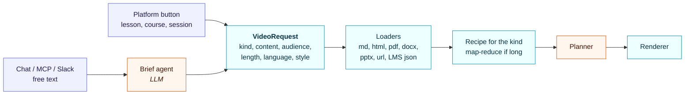

# Roadmap proposal: requests, content and visual variety

Status: section 2 (visual variety) shipped in 0.2.0 as the design engine; see the table at the end. Section 1 is still a proposal. Two open questions:

1. How should callers ask for a video (a lesson, a whole course, a mentoring session, a book), in which formats, and does that need an agent?
2. Why do the videos look alike, and how should the design change with the content?

## 1. Asking for a video

### Proposal: a typed request, with an optional agent in front

Platforms already know what they want, because a "generate video" button sits on a lesson, a course or a session. They should send a **structured request**, not a sentence for a model to interpret. Interpretation costs money, adds a failure mode, and is harder to audit.

An agent belongs only at the **conversational front door**: chat, MCP and Slack, where a person types "make a one-minute recap of module 3 for new managers". There, a small **brief agent** turns the sentence into the same structured request. The person (or the calling agent) confirms it, and the normal pipeline runs.



```python
VideoRequest(
    kind="course_summary",                 # lesson | course_summary | session | explainer | announcement
    content=[ContentRef(url="https://lms/api/courses/42"), ContentRef(path="handbook.pdf", pages="1-30")],
    audience="new people managers",
    length="2m",                           # 30s | 60s | 90s | 2m | 3m
    language="en",
    style="auto",                          # or a style pack (section 2)
    brand_id="...", voice="...",
)
```

### Kinds are recipes

Each kind fixes the structure, the length, and how much content it can take:

| Kind | Typical input | Shape of the video | Long input |
|---|---|---|---|
| `lesson` | one lesson or section | hook, 2–4 ideas, one action (60–90 s) | one pass |
| `course_summary` | a whole course, a book | what you'll learn, journey through modules, outcomes (2–3 min) | **map-reduce**: a cheap model summarizes each lesson or chapter, the main model plans from the summaries |
| `session` | a mentor/mentee or coaching guide | goal of this session, agenda, questions to ask, prep, next step | one pass, with "session N of M" context |
| `explainer` | a policy, a process, a product feature | problem, how it works, what to do | one pass |
| `announcement` | a short note | one message, one action (30 s) | one pass |

Map-reduce makes length a non-issue: a 300-page book costs about as much to plan as its chapter summaries, and those summaries are cached and reused for every video made from the same content.

### Content formats

Every format becomes the same `Source` before planning, so formats and kinds don't multiply each other:

- Have now: Markdown, text, HTML, JSON.
- Add: **PDF** (pypdf), **DOCX** (python-docx), **PPTX** (slide text plus speaker notes), **URL** (fetch and extract the article), and **LMS JSON** (course → modules → lessons). That is the structured path for whole courses.
- Later: SCORM packages, transcripts of recorded sessions.

## 2. Visual variety

### Why they look alike today

There are six scene templates with one layout each, one motion style, and one background treatment. The planner also tends to pick the same sequence: title, list, cards, closer. The brand changes colors and fonts, but not the composition.

### Proposal: style is a decision, made per video and per scene

1. **Style packs** (art direction presets). Each one bundles typography scale, layout grid, background and decoration, motion easing and pacing, and transitions. The brand still supplies colors, fonts and logo; the pack decides how they are used.
   - *editorial*: serif display, large type, rules and whitespace
   - *bold*: full-bleed color blocks, heavy sans, hard cuts
   - *calm*: soft gradients, rounded cards, slow fades
   - *technical*: grid, monospace accents, diagrams
   - *warm*: illustrations, shapes, gentle bounce
2. **More scene types** chosen for what the content *is*:
   - a big number or stat
   - a quote
   - do / don't
   - a timeline
   - numbered steps
   - a checklist
   - an image with caption
   - a simple chart
   - a two-person **dialogue**, with two voices. This suits mentor/mentee and role-play.
3. **Two or three layouts per scene type** (left/right split, centered, stacked). These are picked deterministically so neighbouring scenes differ.
4. **A style director step.** One LLM call picks the pack from kind, audience and tone, then the scene type and layout for each scene, avoiding repeats. It writes into the plan, so an editor can review and override it. Rendering stays deterministic.
5. **Aspect ratios**: 16:9, plus 9:16 for mobile and 1:1 for feeds, from the same plan.
6. **Media**: images (uploaded, taken from the brand's site, or generated), an open icon set, and later an optional presenter avatar.

Expected effect: a course summary in *editorial* style with a timeline, and a compliance explainer in *technical* style with numbered steps, look like different productions, both still on-brand.

## Suggested order

| # | Build | Status |
|---|---|---|
| 1 | `VideoRequest` + kinds + PDF/DOCX/PPTX/URL loaders + course map-reduce | **mostly done in 0.2.0**: 7 video kinds; Word, PowerPoint, PDF and web page loaders. Still open: reading course export zips (SCORM, Common Cartridge) as sources, and summarizing sources over 12,000 words (map-reduce) |
| 2 | Style packs + new scene types + layout variants + style director | **done in 0.2.0**: 7 styles, 28 scene types, 57 layouts, creative director, layout picker |
| 3 | Dialogue scenes with two voices | **done in 0.2.0** |
| 4 | Brief agent for chat/MCP | **done in 0.2.0**: `kinetry brief`, `POST /v1/briefs`, `brief_video` tool |
| 5 | 9:16 and 1:1 | **done in 0.2.0**, with captions |
| 6 | Images (uploaded or from the brand site), image + caption scene | **done in 0.2.0** (generated images still open); icons are done (Lucide) |
| 7 | More transitions and scene types from the HyperFrames registry | **started in 0.2.0**: the scribble transition and four scene types (code, chat thread, line chart, decision) |
| 8 | Motion levels 4 and 5: animated illustrations (SVG, Lottie) and a 3D stage (Three.js) | **done in 0.2.0**, opt-in by name |
| 9 | A first run with no keys | **done in 0.3.0**: `kinetry demo` |
| 10 | LMS output: SCORM 1.2/2004 packages with captions, chapters, transcript and a grounded knowledge check | **done in 0.3.0**: `kinetry package`, `run --package` |
| 11 | One course into many languages | **done in 0.3.0**: `kinetry localize` |
